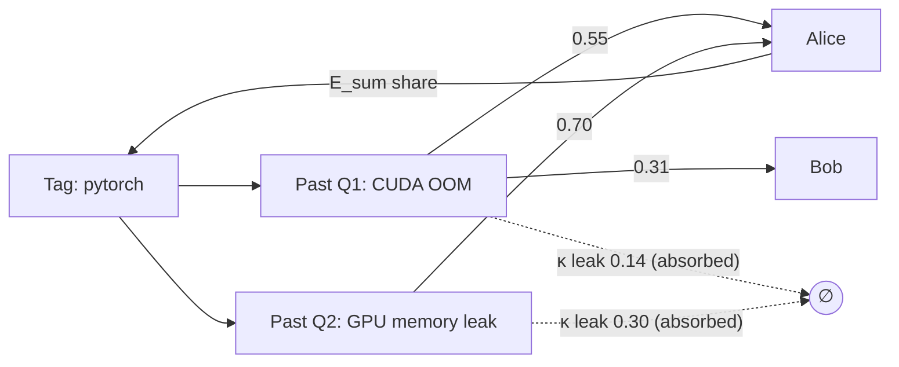

# Quality-Aware Expert Recommendation via Heterogeneous Graph Mining (v3)

## 1. Objective, labels, hypotheses

**Task.** Given a new Stack Overflow question (initial title, body, tags) posted at time `t₀`, rank users by how likely they are to post a *useful* answer, using **only information available before `t₀`**.

**Recommended design.** A **heterogeneous user–question–tag graph** scored with Personalized PageRank (PPR), fused with an **aggregated user–tag expertise table** and, optionally, **question-text retrieval**. No GNN or fine-tuning. Here, "training" means offline data processing, monthly snapshot construction, and validation-based hyperparameter selection.

### 1.1 Labels (fixed horizon)

A label must mean the same thing for every question, regardless of how close it is to the end of the dump. So labels use a **fixed horizon**, not "score at dump time":

- An answer is *eligible* if it was posted within `H_a = 7` days of the question and is not a self-answer.
- Its **label score** counts only votes dated within `H_v = 30` days of the answer.
- **Graded relevance:** accepted within `H_v` → 2; else label score ≥ 1 → 1; else 0.
- **Secondary label ("responded"):** posted any eligible answer → 1. This separates *who responds* from *who answers well* (Section 9.5).

Verify `H_a` and `H_v` before fixing them: plot the share of answers by delay since question, and the share of votes by delay since answer, over a historical year. Choose values that capture ≥ 85–90% of each.

> The last usable evaluation question date is `dump_date − H_a − H_v`.

### 1.2 Hypotheses

Each hypothesis is **one comparison that changes exactly one thing**.

| ID | Hypothesis | Comparison | Only difference |
|---|---|---|---|
| H1 | Historical answer quality predicts useful answers better than activity | B3 vs B2 | quality weights vs counts (same decay, same tag weights) |
| H2 | Link analysis adds value beyond the aggregated user–tag table | B5 vs B3 | adding weighted PPR to the fusion |
| H3 | Quality-weighting the graph improves link analysis | B4w vs B4 | edge weights + `κ` vs all-ones, `κ = 0` |
| H4 | Matching the specific question text adds value beyond tags | B6 vs B5 | adding text (one variant, picked on validation) |

**Decision rule:** if B5 doesn't significantly beat B3 (or B6 doesn't beat B5), prefer the simpler system and report that as the result.

## 2. Data

### 2.1 Source

Use the **Stack Exchange data dump** (`Posts`, `Votes`, `PostHistory`, `Tags`, and tag synonyms). Check the current access terms first, since dump distribution changed in 2024. The Stack Exchange Data Explorer (SEDE) is handy for prototyping tag subsets and checking volumes before downloading.

| Table | Fields used | Why |
|---|---|---|
| `Posts` (questions) | `Id`, `Title`, `Body`, `Tags`, `CreationDate`, `OwnerUserId`, `ClosedDate` | Historical corpus, asker exclusion |
| `Posts` (answers) | `Id`, `ParentId`, `OwnerUserId`, `CreationDate`, `CommunityOwnedDate` | Expertise evidence, labels |
| `Votes` | `PostId`, `VoteTypeId` (1 accept, 2 up, 3 down), `CreationDate` (day-level) | **Point-in-time** score and acceptance |
| `PostHistory` | `PostId`, `PostHistoryTypeId` 1/2/3, `Text` | **Initial** title / body / tags of evaluation questions |
| `TagSynonyms` | source → target | Map synonyms to master tags |

### 2.2 Extraction

`Posts.xml`, `Votes.xml`, and `PostHistory.xml` are very large. Never load them whole:

1. Stream-parse with `lxml.etree.iterparse` (clearing elements as you go) into Parquet.
2. Filter `Posts` to the tag cluster first, then filter `Votes` to the kept post IDs, and `PostHistory` to evaluation question IDs and types 1/2/3 only.
3. Do joins and aggregations in DuckDB over Parquet.

**Sanity check:** the vote-reconstructed final score should closely match `Posts.Score` (vote reversals make it inexact). Report the agreement rate.

### 2.3 Tag cluster

Choose 3–6 specific **seed tags** in one domain (e.g., `pytorch`, `tensorflow`, `keras`, `cuda`). Expand with tags whose questions co-occur with the seeds above a threshold. Include a question if it has **at least one cluster tag**. Generic tags (`python`) still become tag nodes but never qualify a question on their own; IDF weighting (Section 4.4) handles them. Target ~50k–150k historical questions.

### 2.4 Periods and volume check

Question volume and the answerer population changed sharply after ChatGPT's launch (Nov 2022). So run the **main experiment entirely before it**, and treat the later period as a **distribution-shift test**.

| Split | Default window | Use |
|---|---|---|
| History | 2017-01 → 2021-06 | Features only |
| Validation | 2021-07 → 2021-12 | Tuning (first 4 months), overfitting check / LTR comparison (last 2) |
| Test (main) | 2022-01 → 2022-09 | Touched once; horizon ends before the launch |
| Test (shift) | 2023-07 → 2024-06 | Frozen system; report as a finding |

Before fixing these windows, count per month the cluster questions with ≥ 1 useful (horizon) answer. Aim for ≥ 2,000 validation and ≥ 3,000 main-test questions; widen the cluster or shift windows if short. Report the volume trend either way.

### 2.5 Cleaning

- Drop answers with no owner and community-wiki answers.
- Keep self-answers as expertise evidence; exclude them from labels; always exclude the asker from candidates.
- Exclude questions closed as duplicates from the evaluation queries (keep them in history).
- Strip HTML. Build **two text views**: a BM25 view that keeps inline code, identifiers, and the first ~3 lines of each code block or traceback; and a dense view of title + ~200 words of prose.

## 3. Point-in-time rules (single source of truth)

For each validation/test month `M`, the **snapshot** `S_M` contains only data dated **before the first day of `M`**. Every feature for every question posted in `M` comes from `S_M`. Staleness is bounded at one month.

| Item | Rule |
|---|---|
| Answers, votes, acceptance | Dated `< first day of M` (vote dates are day-level, so this boundary is exact) |
| Activity window, `df(t)`, `μ_t`, `κ` | Computed from `S_M` |
| Retrieval corpus / BM25 statistics | Questions created `< first day of M` |
| Query question | **Initial** title, body, tags from `PostHistory` (later edits and retags are often made by answerers) |
| Never used as features | `Users.Reputation`, `LastAccessDate`, `Posts.Score`, `ViewCount`, `AnswerCount`, `FavoriteCount`, `ClosedDate` |
| Labels | Votes after `t₀`, within the fixed horizon (Section 1.1) |

Known residual: posts deleted after `t₀` are missing from the dump. This can't be fixed; state it.

## 4. Quality and expertise signals

### 4.1 Answer quality (horizon-capped)

Raw score rewards answer age: a 2017 answer has had years to collect votes. Cap the vote window the same way as the labels:

$$
\mathrm{score}_M(a) = \#\text{up} - \#\text{down}\ \text{ dated in } [t_a,\ \min(t_a + H_v,\ M))
$$

$$
q(a;M) = \epsilon + \log\bigl(1 + \max(0, \mathrm{score}_M(a))\bigr) + \beta\,\mathbf{1}[a \text{ accepted before } M]
$$

Defaults: `ε = 0.1`, `β = 1`. Answers younger than `H_v` carry their partial score. Ablation: uncapped point-in-time score.

**Implementation:** precompute, once, each answer's vote events sorted by day with cumulative sums. Any snapshot's score is then a vectorized `searchsorted`.

### 4.2 Recency decay (applied once, at the answer level)

$$
w_\tau(a;M) = \exp\!\left(-\frac{t_M - t_a}{\tau}\right),\qquad q_\tau(a) = q(a)\,w_\tau(a)
$$

Default `τ = 365` days; `τ = ∞` is an ablation. Decay lives **only** here. The graph needs no separate `Tag → Question` decay: a question whose answers are all old has small `q_τ` relative to `κ`, so most of its mass leaks (Section 5).

### 4.3 User–tag expertise

With `w_{a,t} = 1[t ∈ tags(q_a)] / |tags(q_a)|`, use **decayed** sums and counts so that quality and recency stay separate:

$$
E_{\mathrm{sum}}(u,t) = \sum_{a \in A(u)} w_{a,t}\, q_\tau(a),\qquad
n_\tau(u,t) = \sum_{a \in A(u)} w_{a,t}\, w_\tau(a),\qquad
\mu_t = \frac{\sum_u E_{\mathrm{sum}}(u,t)}{\sum_u n_\tau(u,t)}
$$

$$
\bar E(u,t) = \frac{E_{\mathrm{sum}}(u,t) + m\,\mu_t}{n_\tau(u,t) + m},\qquad
E_{\mathrm{prod}}(u,t) = \bar E(u,t)\cdot\log\bigl(1 + n_\tau(u,t)\bigr)
$$

Default `m = 5`. Store `E_sum`, `n_τ`, and `E_prod` as sparse `|T| × |U|` matrices per snapshot. `E_sum` defines the `User → Tag` edges; `E_sum` vs `E_prod` as the ranking feature is chosen on validation.

### 4.4 Query aggregation

Tag weights from snapshot IDF, normalized to sum to 1 (tags unseen in `S_M` get 0):

$$
\pi_t \propto \log\frac{N_{Q,M}}{\mathrm{df}_M(t)},\qquad
E(u, q^*) = \sum_t \pi_t\, E(u,t)
$$

For a whole month's queries this is a single sparse product, `Π (B × |T|) · E (|T| × |U|)`.

## 5. Graph and PPR

### 5.1 Schema

**Nodes:** users `U`, historical questions `Q`, tags `T` (all from `S_M`).

| Directed edge | Transition probability |
|---|---|
| `Tag → Question` | `1 / |Q_t|` over the tag's questions |
| `Question → User` | `Σ_{a∈A(q), author u} q_τ(a) / (Σ_{a∈A(q)} q_τ(a) + κ)` |
| `User → Tag` | `E_sum(u,t) / Σ_{t'} E_sum(u,t')` |

Rows may sum to less than 1 (the `κ` leak, questions with no answers). That mass is **absorbed** (dropped), not renormalized. Asker relationships are stored but not walked (asking shows interest, not expertise); adding `Asker → Answerer` edges is an ablation.

`κ = c × median(q_τ)` over the snapshot's answers, with `c ∈ {0, 0.5, 1, 2}`. Without `κ`, a question with one weak answer would send all its mass to that answerer.



**Worked example** (no decay, `ε = 0.1`, `β = 1`, `κ = 1`):

| Question | Tags | Answerer | Score | Accepted | `q(a)` |
|---|---|---|---:|---|---:|
| Q1 | `pytorch`, `cuda` | Alice | +15 | Yes | 3.87 |
| Q1 | `pytorch`, `cuda` | Bob | +7 | No | 2.18 |
| Q2 | `pytorch`, `cuda` | Alice | +8 | No | 2.30 |

- `E_sum(Alice, pytorch) = (3.87 + 2.30) / 2 ≈ 3.09`; `E_sum(Bob, pytorch) = 2.18 / 2 = 1.09`.
- Q1 → Alice 3.87/7.05 = 0.55, Bob 2.18/7.05 = 0.31, leak 0.14. Q2 → Alice 2.30/3.30 = 0.70, leak 0.30. A lone weak answer (`q = 0.1`) gets only 0.09.

### 5.2 PPR (absorbing, batched)

$$
x = (1-d)\,s + d\,P^\top x
$$

Absorbing the leak instead of returning it to `s` gives **the same ranking per query** (the renormalized solution is a scalar multiple of this one), and it makes `x` **exactly linear in `s`**, which enables batching and caching.

**Damping.** The graph is a 3-cycle (T→Q→U→T), so with tag restarts users receive mass at hops 2, 5, 8, …. Only `1 − d³` of it comes from the first pass: 39% at `d = 0.85` and 88% at `d = 0.5`. Higher `d` drifts toward prolific, broad users. Start at `d = 0.5` and tune over `{0.3, 0.5, 0.7, 0.85}`.

```python
import numpy as np

def ppr_batch(P_T, S, d=0.5, tol=1e-7, max_iter=100):
    """P_T: CSR transpose of the sub-stochastic transition matrix, shape (n, n).
    S: dense restart matrix, shape (n, B); each column sums to 1.
    Returns X with x = (1-d) * sum_k (d P^T)^k s per column. Leaked mass is absorbed."""
    term = (1 - d) * S
    X = term.copy()
    for _ in range(max_iter):
        term = d * (P_T @ term)          # next Neumann-series term
        X += term
        if term.sum(axis=0).max() < tol:  # all entries are non-negative
            break
    return X
```

**Evaluation:** score each month's queries in one batch (`S` has one column per query). That is one sparse-dense product per iteration instead of thousands of single-query runs.

**Demo / online:** cache the **user entries** of the per-tag vectors `x_t` for the latest snapshot only. By linearity, any query composes exactly from them:

$$
x_{\text{tags}} = \sum_t \pi_t\, x_t,\qquad
x_u = (1-d)\,e_u + d\sum_t P(u,t)\,x_t,\qquad
x_q = (1-d)\,e_q + d\sum_u P(q,u)\,x_u
$$

So question seeds (Section 6) need no extra PPR run either.

**One-hop diagnostic:** `PPR₁(u) = Σ_t π_t Σ_q P(t,q) P(q,u)`. If it matches full PPR, the graph's value is local (essentially tag-smoothed expertise). That is worth reporting under H2.

## 6. Text module (for B6)

**Retrieval** (questions created before `M`, top `K`):

1. **BM25** on the BM25 view. Use a fast library (e.g., `bm25s`) and rebuild per snapshot from the date-sorted prefix; indexing ~100k documents takes seconds.
2. **Dense:** `all-MiniLM-L6-v2` as the baseline and `bge-small-en-v1.5` as a candidate. Both are 384-d. Embed the corpus once (GPU, batch size 128–256, L2-normalized, rows sorted by creation date), store as `.npy`, and memory-map it.
3. **Hybrid:** RRF over the BM25 and dense lists.

Pick **one** variant on validation for H4.

**No FAISS needed at this scale.** For a month's batch of query vectors `Qv` (`B × 384`), compute `Qv @ V[:n_M].T` with NumPy over the date prefix `n_M` (prefix filtering is exact, so no over-fetching is needed). Add FAISS only if the demo needs it.

**Uses of retrieval:**

- **Seeds:** `s = (1−γ) Σ_t π_t e_t + γ Σ_{q∈N_K} ŝim(q) e_q`, with `ŝim` normalized to sum 1. Default `γ = 0.4`.
- **TextSim:** `TextSim(u) = Σ_{q∈N_K} sim(q*, q) · Σ_{a∈A(q), author u} q_τ(a)`. It is 0 for users who answered none of the retrieved questions.

## 7. Inference pipeline

**Step 0: candidate pool (shared by every system).** Users with ≥ 1 cluster answer within the last `W` days of the snapshot (default 180), minus the asker. **Every system ranks this entire pool**, so all systems share one ceiling. Choose `W` once on validation by trading **candidate recall** against pool size, before tuning any system. Report:

- **Candidate recall:** the share of evaluation questions with ≥ 1 labeled answerer in the pool.
- **Cold-start share:** the share of labeled answerers with no history in `S_M`.

**Step 1: components.** `E(u, q*)`, PPR user scores, and (optionally) TextSim, all vectorized over the pool.

**Step 2: normalization.** Per component and per query, within the pool: `z = standardize(log1p(x / median_nonzero(x)))`. Dividing by the median makes `log1p` meaningful for tiny PPR values; z-scores keep magnitude, unlike percentile ranks.

**Step 3: fusion.** Compare:

- **RRF** (parameter-free): `S(u) = Σ_c 1 / (60 + rank_c(u))`.
- **Weighted linear:** `S = Σ_c λ_c z_c`, with `λ` on the simplex, grid step 0.1.

**Ties.** Break ties with a fixed per-question random permutation of users, **identical across systems**.

**Step 4: explanation.** For each recommended user, show the top query tags by `π_t · E(u,t)` and their 2–3 best past answers on the most similar retrieved questions, with score and accept status. *Example:* Alice ranks above Bob. Both have PyTorch/CUDA evidence, but Alice has more high-quality answers there (`E_sum` 3.09 vs 1.09), an accepted answer on the closest past question (Q1), and recent activity.

**Optional final system (B7).** Learning-to-rank (LightGBM LambdaRank) over all components plus **availability features**:

- the user's smoothed share of past answers within ±2 hours of `t₀`'s hour-of-week (answer timestamps have full time; only votes are day-level);
- days since the user's last answer.

Train on validation months 1–4 and compare with linear fusion on months 5–6. Adopt it only if it wins there.

## 8. Offline build

1. **Extract** (Section 2.2) to Parquet; run the score sanity check and the horizon curves.
2. **Volume check** → fix the periods and tag cluster.
3. **Precompute once:** cumulative vote arrays per answer, per-answer tag weights `w_{a,t}`, initial query text and tags, embeddings.
4. **Per snapshot `M`:** `q_τ` → sparse `E_sum`, `n_τ`, `E_prod` → CSR transition matrix → BM25 index over the prefix. Time each step; expect seconds to minutes.
5. **Per month's queries:** batched PPR, batched retrieval, vectorized fusion and metrics.
6. **Cache by dependency** so tuning recomputes only what changed:

| Artifact | Depends on |
|---|---|
| `q_τ`, `E`, `n_τ` | `ε`, `β`, `τ`, `m` |
| Graph | + `κ` |
| PPR | + `d`, `γ`, `K`, text variant |
| Fused ranking | + fusion method, `λ` |

**Storage:** Parquet for posts, answers, votes, and per-snapshot quality; `.npz` for sparse matrices per snapshot; `question_embeddings.npy` + `question_ids.npy` (same row order, sorted by date). At 100k × 384, the embedding matrix is ~146 MiB in `float32`.

## 9. Evaluation

### 9.1 Protocol

- **Queries:** cluster questions posted in the split, not closed as duplicates, with ≥ 1 useful label (Section 1.1).
- **Features:** from snapshot `S_M` for the question's month.
- **Ranking:** the full shared candidate pool. Never use sampled negatives; they can reorder systems.
- **Ground-truth caveat:** qualified users who didn't answer count as misses. Compare systems relatively, and report the distribution of labeled answerers per question (many questions have one, which makes Recall@k close to a hit rate).

### 9.2 Systems

| System | Score | Role |
|---|---|---|
| B0 | Cluster answers in the query's tags in the last 90 days, weighted by `π_t` | Availability / popularity floor (often strong) |
| B1 | Vote-based reputation proxy as of `M` (cluster posts only): +10 per answer upvote, question upvotes +5 before Nov 2019 and +10 after, +15 accept, −2 downvote | Global popularity |
| B2 | `Σ_t π_t n_τ(u,t)` | Activity without quality (H1) |
| B3 | `Σ_t π_t E(u,t)` (`E_sum` or `E_prod`, chosen on validation) | Quality expertise (H1, H2) |
| B4 | PPR, all edge weights 1, `κ = 0`, tag restart by `π_t` | Graph structure alone (H3) |
| B4w | PPR with quality weights and `κ` | Quality-weighted graph (H3) |
| B5 | Fusion of B3 + B4w | H2, H4 |
| B6 | B5 + text (seeds + TextSim, one variant) | H4 |
| B7 *(optional)* | LTR over all components + availability | Best achievable system |

**Ablations on B5/B6:** `τ = ∞`; `β = 0`; `κ = 0`; uncapped score; uniform vs IDF `π_t`; `E_sum` vs `E_prod`; RRF vs linear fusion; one-hop PPR; with `Asker → Answerer` edges; no availability filter (pool = all users with cluster history).

### 9.3 Metrics and statistics

- **Accuracy:** NDCG@10 (graded, primary), Recall@5, Recall@10, MRR@10.
- **Ceilings:** candidate recall, cold-start share.
- **Load concentration:** share of all top-5 slots taken by the 1% most-recommended users, plus the Gini coefficient. A system that routes everything to the same 20 experts is impractical even if accurate.
- **Latency:** p50/p95 per query for the demo path (cached per-tag vectors) and for the batched evaluation path (per month).
- **Significance:** paired bootstrap 95% CIs over questions and a paired randomization test for H1–H4, with Holm correction across the four.
- **Segments:** head vs tail tags; users with few vs many past answers; questions with 1 vs ≥ 2 labeled answerers.

### 9.4 Tuning (validation months 1–4, staged, equal effort for baselines)

Select by NDCG@10. When configurations are within the bootstrap CI of each other, take the simpler one. Freeze everything, then touch the test set once.

| Stage | Parameters (start → range) | Tuned on |
|---|---|---|
| 0 | `W` activity window: 180 → {90, 180, 365} | Candidate recall vs pool size |
| 1 | `ε` 0.1 → {0.05, 0.1, 0.5}; `β` 1 → {0, 0.5, 1, 2}; `τ` 365 → {90, 180, 365, ∞}; `m` 5 → {2, 5, 10}; `E_sum`/`E_prod` | B3 (table only, cheap, full grid) |
| 1b | B0 window {30, 90, 180}; B2 `τ` {90, 180, 365, ∞} | Baselines get their own tuning |
| 2 | `c` (κ) 1 → {0, 0.5, 1, 2}; `d` 0.5 → {0.3, 0.5, 0.7, 0.85} | B4w (and `d` for B4) |
| 3 | `γ` 0.4 → {0, 0.2, 0.4, 0.6}; `K` 50 → {20, 50, 100}; text variant; fusion method; `λ` (step 0.1) | B5 / B6 |

Months 5–6 of validation check for overfitting (the tuned config should still beat its baselines there) and host the B7 comparison.

### 9.5 Additional analyses

- **Responded vs useful:** evaluate B0, B2, and B3 on the secondary label. If activity wins on "responded" but quality wins on "useful", that is the cleanest reading of H1.
- **Distribution shift:** run the frozen systems on the shift test set. Report per-month metrics, candidate recall, and the volume trend alongside the main test.

## 10. Risks and mitigations

| Risk | Effect | Mitigation |
|---|---|---|
| Label censoring | Late questions look harder; val/test labels differ | Fixed horizon `H_a`, `H_v` |
| Post-hoc edits / retags | Query leaks expert input | Initial title/body/tags from `PostHistory` |
| Snapshot-field leakage | Inflated results | Votes-based reconstruction; Section 3 checklist |
| Pool bias | Systems compared under different ceilings | One eligibility-based pool for all systems |
| Declining SO volume / LLM shift | Small, shifted test set | Pre-Nov-2022 main test; separate shift test |
| Cold-start answerers | Unrecoverable positives | Report candidate recall and cold-start share; segment by history |
| Popularity bias | Every method converges on the same users | Low-`d` PPR; `E_prod` smoothing; load-concentration metric |
| Label noise | Qualified non-answerers count as misses | Graded labels; relative comparisons; responded-label analysis |
| Too many knobs | Overfitting validation | Staged tuning; months 5–6 check; test touched once |
| Data size | Slow or failed extraction | Streaming parse; filter early; DuckDB over Parquet |

## 11. Roadmap (priority-ordered, with exit criteria)

| # | Milestone | Priority | Exit criteria |
|---|---|---|---|
| 1 | Extraction, score sanity check, horizon curves, volume check | Must | Per-month counts, label distribution, fixed periods and cluster |
| 2 | MVP: B0–B3, shared pool, evaluation harness with bootstrap CIs | Must | H1 answered; candidate recall known |
| 3 | Graph: snapshots, B4/B4w/B5, batched PPR, one-hop diagnostic | Must | H2, H3 answered; latency measured |
| 4 | Text: BM25 first (B6) | Should | H4 answered |
| 5 | Ablations, segments, responded-label and shift analyses | Should | Write-up tables complete |
| 6 | Dense embeddings (MiniLM vs bge-small) | Could | Text variant selected |
| 7 | B7 (LTR + availability) | Could | Adopted or rejected on validation months 5–6 |
| 8 | Demo: FastAPI + minimal UI (or a notebook) with explanations | Could | Shows answers with CC BY-SA attribution and links |

**Minimal stack:** Python, `lxml`, DuckDB + Parquet, NumPy/SciPy sparse, `bm25s`. Optional: Sentence Transformers, LightGBM, FastAPI.

## Appendix: changes from v2

- Labels use a fixed horizon instead of "score at the end of the dump"; added a secondary "responded" label.
- Query title, body, and tags come from their initial revisions in `PostHistory`.
- One eligibility-based candidate pool shared by all systems, replacing the top-200 union built from the proposed system's own components.
- Added B4w; each hypothesis now changes exactly one thing (B2 uses the same decay as B3).
- PPR absorbs leaked mass: the same rankings, but exact linearity, batched evaluation, and exact composition from per-tag caches.
- Default `d` lowered to 0.5 (the 3-cycle argument) and a one-hop diagnostic added.
- Decay applied once (answer level); `Ē` and `E_prod` use the decayed count `n_τ`.
- Answer quality uses a horizon-capped score to remove the answer-age advantage.
- A single snapshot rule (before the first day of `M`) for all features, including `df`, `μ_t`, `κ`, and BM25 statistics.
- Main test before Nov 2022, plus a separate shift test.
- Staged tuning with a dependency cache; baselines get equal tuning effort.
- Fixed tie-breaking; z-score normalization instead of percentile ranks after `log1p`.
- NumPy prefix search replaces FAISS; BM25 rebuilt per snapshot; bge-small added as a dense candidate.
- Optional availability features and B7; the roadmap is priority-ordered.
- Citations removed.
