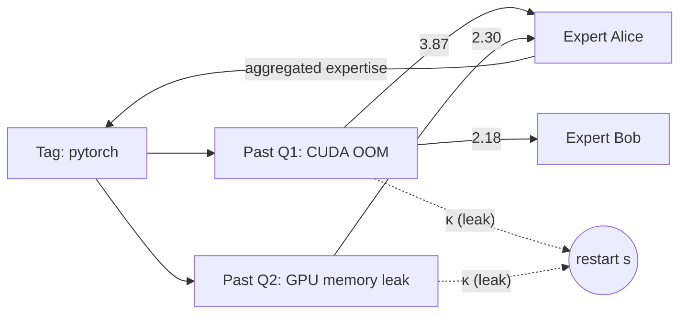

# Quality-Aware Expert Recommendation via Heterogeneous Graph Mining (v2)

## 1. Objective, hypotheses, and scope

**Task:** Given a new Stack Overflow question (title, body, tags) posted at time `t₀`, rank users by how likely they are to post a *useful* answer, using **only information available before `t₀`**.

**Label definition (what "useful" means):** an answer that is accepted, or has score ≥ 1 at the end of the data window. For graded metrics: accepted = 2, score ≥ 1 = 1, otherwise 0. Exclude self-answers (answerer = asker) from labels.

> **Leakage rule:** *labels* may use information after `t₀`, because they are the outcome being predicted. *Features* may not. Every feature in this plan is computed "as of `t₀`".

**Hypotheses.** Each one maps to a single comparison in Section 8, so the results section writes itself.

| ID | Hypothesis | Comparison |
|---|---|---|
| H1 | Historical answer *quality* predicts useful answers better than activity alone | B3 vs B2 |
| H2 | Link analysis over the graph adds value beyond an aggregated user–tag table | B5 vs B3 |
| H3 | Quality-weighting the graph edges improves link analysis | B5 vs B4 |
| H4 | Matching the specific question text adds value beyond tags | B6 vs B5 |

**Recommended design:** A **heterogeneous user–question–tag graph** for Personalized PageRank (PPR), plus a separate **aggregated user–tag expertise table** for cheap scoring. Historical question nodes are kept because they preserve answer provenance and enable question-level retrieval. Future answers are never added to the graph when recommending for a new question.

No graph neural network or fine-tuning is needed for the first version. Here, **"training" means offline data processing, graph construction, score precomputation, and validation-based hyperparameter selection**.

## 2. Data source, period, and cleaning

### 2.1 Source

Prefer the **Stack Exchange data dump** (`Posts`, `Votes`, `Users`, `Tags`) over the API for the main experiments:

- `Votes` records each vote with a (day-level) date: type 1 = accepted, 2 = upvote, 3 = downvote. This lets you **reconstruct an answer's score and accept status as of any cutoff**, which the API cannot do (it only returns current scores).
- The API is fine for a small prototype or for a live demo, but it is rate-limited and snapshot-only.
- Dump distribution changed in 2024; check the current access terms before planning around it.

### 2.2 Period and volume check (do this before fixing cutoffs)

Stack Overflow question volume has fallen sharply since 2023, so recent periods may be too thin and the answerer population may have shifted.

1. Count, per tag and per month, questions that have at least one useful answer.
2. Aim for roughly ≥ 2,000 validation and ≥ 3,000 test questions. If 2025–2026 is too small, widen the tag set or shift windows earlier (e.g., build 2020–2022, validate 2023, test 2024).
3. Report the volume trend anyway; distribution shift between build and test is a legitimate finding.

Start with ~50k–100k historical questions from a coherent tag cluster (e.g., `python`, `pytorch`, `cuda`, `pandas`, `docker`). Map tag synonyms to their master tag.

### 2.3 Records

| Record | Needed fields | Purpose |
|---|---|---|
| Question | `question_id`, `title`, `body`, `tags`, `creation_date`, `owner_user_id` | Query topics, retrieval, timestamp, asker exclusion |
| Answer | `answer_id`, `question_id`, `owner_user_id`, `creation_date`, `community_owned_date` | Expertise evidence |
| Votes | `post_id`, `vote_type_id`, `creation_date` | **Point-in-time** score and acceptance |
| User | `user_id` | Identity (do **not** use the dump's current `Reputation` as a feature; see B1) |

### 2.4 Cleaning

- Drop answers with no owner (deleted/anonymous users) and community-wiki answers.
- Keep self-answers as expertise evidence, but exclude them from labels and always exclude the asker from candidates.
- Strip HTML, keep code identifiers and error strings (they matter for BM25), and truncate long stack traces before embedding.

## 3. Graph schema

**Nodes:** users `U`, historical questions `Q`, tags `T`.

| Directed edge | Weight before row-normalization | Notes |
|---|---|---|
| `Tag → Question` | 1, optionally × recency decay `w_τ` | Without decay, a big tag (`python`) spreads mass over old questions |
| `Question → User` | `q_τ(a)` for each answer `a` by `u` | Plus a **leak weight `κ`** back to the restart distribution (Section 4.4) |
| `User → Tag` | `E_sum,τ(u, t)` | Aggregated demonstrated expertise |

Asker relationships are stored separately and never walked: asking about a tag shows **interest**, not expertise. Add reverse edges only if an ablation shows they help.



## 4. Answer quality and topic expertise

### 4.1 Point-in-time answer quality

$$
q(a;t_0)=\epsilon+\log\bigl(1+\max(0,\operatorname{score}_{t_0}(a))\bigr)+\beta\,\mathbf{1}[a\text{ accepted before }t_0]
$$

where `score_{t₀}(a)` = upvotes − downvotes cast before `t₀`, reconstructed from `Votes`. Initial values `ε = 0.1`, `β = 1` are heuristics to tune, not probabilities. Negative-score answers get the small baseline `ε` so no edge is negative.

> Since vote dates are day-level, use "votes dated strictly before the day of `t₀`".

### 4.2 Recency decay

Users leave, and topics move (e.g., PyTorch APIs change). Weight each answer by age:

$$
w_\tau(a;t_0)=\exp\!\left(-\frac{t_0-t_a}{\tau}\right),\qquad q_\tau(a;t_0)=q(a;t_0)\,w_\tau(a;t_0)
$$

Start with `τ = 365` days; `τ = ∞` (no decay) is an ablation.

### 4.3 User–tag expertise

Distribute each answer's evidence over its question's tags, with `w_{a,t} = 1[t ∈ tags(q_a)] / |tags(q_a)|`:

$$
E_{\mathrm{sum}}(u,t)=\sum_{a:\,\mathrm{author}(a)=u} w_{a,t}\,q_\tau(a),\qquad n(u,t)=\sum_{a:\,\mathrm{author}(a)=u} w_{a,t}
$$

`E_sum` rewards volume, so prolific users dominate. For ranking, also compute a **smoothed mean × volume** score, shrinking users with few answers toward the tag mean `μ_t`:

$$
\bar E(u,t)=\frac{E_{\mathrm{sum}}(u,t)+m\,\mu_t}{n(u,t)+m},\qquad
E_{\mathrm{prod}}(u,t)=\bar E(u,t)\cdot\log\bigl(1+n(u,t)\bigr)
$$

with `m = 5` as a starting prior strength. Use `E_sum` for the `User → Tag` edge weights and compare `E_sum` vs `E_prod` as the expertise feature.

For a query with tag weights `π_t` (Section 6, step 1): `E(u, q*) = Σ_t π_t · E(u, t)`.

### 4.4 Worked example (no decay, illustrative scores)

| Historical question | Tags | Answerer | Score | Accepted | `q(a)` |
|---|---|---|---:|---|---:|
| Q1: Fix CUDA OOM | `pytorch`, `cuda` | Alice | +15 | Yes | 3.87 |
| Q1: Fix CUDA OOM | `pytorch`, `cuda` | Bob | +7 | No | 2.18 |
| Q2: GPU memory leak | `pytorch`, `cuda` | Alice | +8 | No | 2.30 |

Each question has two tags, so each tag gets half of each answer's quality:

- `E_sum(Alice, pytorch) = E_sum(Alice, cuda) = (3.87 + 2.30)/2 ≈ 3.09`
- `E_sum(Bob, pytorch) = E_sum(Bob, cuda) = 2.18/2 = 1.09`

**Fixing the normalization problem with a leak weight `κ`.** If `Question → User` were normalized only over answerers, a question with one weak answer would send probability 1 to that answerer, erasing absolute quality. Instead normalize over answerers **plus `κ`**, and send the leaked mass back to the restart distribution:

$$
P(Q\to u)=\frac{\sum_{a\in A(Q),\,\mathrm{author}(a)=u}q_\tau(a)}{\sum_{a\in A(Q)}q_\tau(a)+\kappa}
$$

With `κ = 1`:

- Q1: Alice 3.87/7.05 = 0.55, Bob 2.18/7.05 = 0.31, leak 0.14.
- Q2: Alice 2.30/3.30 = 0.70, leak 0.30. A single weak answer (`q = 0.1`) would get only 0.09, not 1.

`κ = 0` reproduces plain normalization and is an ablation. A good starting value is the median `q` across answers. The independent expertise score `E` stays in the final fusion anyway.

## 5. Offline build ("training")

1. **Choose periods** after the volume check (Section 2.2).
2. **Use monthly snapshots.** For each month `M` in validation/test, build every feature from data dated before the first day of `M`, then score `M`'s questions. Staleness is bounded at one month, which avoids freezing a single graph for a whole year. At this scale a rebuild should take seconds to minutes; time it.
3. **Extract and clean** (Section 2.4).
4. **Compute point-in-time quality** `q_τ(a; t_M)` per snapshot.
5. **Build both views:** the sparse graph (with `κ` leak) and the `(user_id, tag) → (E_sum, n, E_prod)` table.
6. **Row-normalize transitions.** Any row summing to less than 1 (leak or dangling node) returns its deficit to the restart distribution, as in the PPR code in Section 6.
7. **Precompute** the active-user list, per-tag candidate lists, and optionally PPR vectors for frequent tag combinations.
8. **Optional embeddings** (Section 7). Embed once for all questions; filter by date at query time.
9. **Tune hyperparameters on validation only** (Section 8.4). Touch the test set once.

## 6. Online inference

**Example input:**

> "Why does PyTorch GPU memory keep growing during training?"
> Tags: `python`, `pytorch`, `cuda`

**Step 0 — Candidate pool.** Keep users who answered at least once in the last 180 days before `t₀` (an availability filter; tune the window), and exclude the asker. Take the union of the top-200 users by `E`, by PPR, and by TextSim. Log **candidate recall**: the share of test questions where at least one labeled answerer is in the pool. That is the ceiling for every metric.

**Step 1 — Tag restart weights.** Weight query tags by specificity instead of by hand:

$$
\pi_t\propto\log\frac{N_Q}{\mathrm{df}(t)}
$$

so a generic tag like `python` automatically gets less weight than `cuda`. (A hand-set example such as `pytorch: 0.45, cuda: 0.45, python: 0.10` is what this tends to produce.)

**Step 2 — Optional similar-question seeds.** Retrieve the top-`K` past questions (created before `t₀`) similar to the new title/body. Split the restart distribution `s`, e.g., 60% over tags by `π_t` and 40% over retrieved questions by similarity. The new question needs no answer edges.

**Step 3 — Weighted PPR on the snapshot graph:** `r = (1−d)s + dPᵀr`, with `d = 0.85` initially.

```python
import numpy as np

def ppr(P_T, s, d=0.85, tol=1e-8, max_iter=100):
    """P_T: transpose of the (sub-)stochastic transition matrix, scipy CSR, shape (n, n).
    Rows of P may sum to < 1 (κ leak, dangling nodes); the missing mass is returned to s."""
    r = s.copy()
    for _ in range(max_iter):
        r_next = (1 - d) * s + d * (P_T @ r)
        r_next += (1.0 - r_next.sum()) * s   # leak + dangling mass back to restart
        if np.abs(r_next - r).sum() < tol:
            break
        r = r_next
    return r_next
```

Read user-node scores from `r`. Expect on the order of 0.1 s per query at ~100k questions with SciPy; measure it, and cache per-tag vectors if it's too slow (PPR is linear in `s`, so a tag-only query is just `Σ_t π_t · PPR_t`).

**Step 4 — Fusion.** PPR and expertise scores are heavy-tailed, so put every component on a comparable scale **within the candidate pool**: apply `log1p`, then convert to percentile ranks. Compare two fusion methods:

- **Reciprocal Rank Fusion (parameter-free baseline):** `S(u) = Σ_c 1/(60 + rank_c(u))`.
- **Weighted linear fusion:** `S = λ_g·PPR̃ + λ_e·Ẽ + λ_s·TextSim̃`, with `λ` on the simplex, grid-searched in 0.05 steps on validation. If text is disabled, drop `λ_s` and renormalize.

Optional extension: train a small learning-to-rank model (logistic regression or LightGBM LambdaMART) on these features, using validation-period questions as training queries. Only adopt it if it beats linear fusion on a separate held-out month.

**Step 5 — Explanation.** For each recommended user, show the top contributing query tags (largest `π_t · E(u,t)`) and their top 2–3 past answers to the most similar retrieved questions, with score and accept status.

**Example output:** Alice ranks above Bob: both have PyTorch/CUDA evidence, but Alice has more high-quality answers there (`E_sum` 3.09 vs 1.09), an accepted answer on the closest past question (Q1), and recent activity.

## 7. Optional semantic module

**Model:** [`sentence-transformers/all-MiniLM-L6-v2`](https://huggingface.co/sentence-transformers/all-MiniLM-L6-v2), 384-dimensional, small enough for a student project. Encode title + cleaned body excerpt, without long code blocks or stack traces. It truncates at 256 word pieces by default, so document your truncation strategy.

**Always compare against BM25**, which tends to win on exact error messages and identifiers. A hybrid (BM25 ∪ dense top-`K`) is cheap to add.

**Defining TextSim.** Let `N(q*)` be the top-`K` retrieved past questions (created before `t₀`):

$$
\mathrm{TextSim}(u,q^*)=\sum_{q\in N(q^*)}\mathrm{sim}(q^*,q)\sum_{a\in A(q),\,\mathrm{author}(a)=u}q_\tau(a)
$$

Users who answered none of the retrieved questions get 0.

**Fast computation:** embed the corpus **once** offline with GPU batching (try batch sizes 64/128/256; smaller on CPU). `model.encode` already runs in inference mode. Only the new question is encoded at query time.

```python
import numpy as np
import faiss
from sentence_transformers import SentenceTransformer

# rows = [(question_id, "title + cleaned body excerpt"), ...] sorted by creation_date
model = SentenceTransformer("sentence-transformers/all-MiniLM-L6-v2", device="cuda")
ids = np.array([qid for qid, _ in rows], dtype=np.int64)
vecs = np.lib.format.open_memmap(
    "question_embeddings.npy", mode="w+", dtype="float32", shape=(len(rows), 384)
)
for start in range(0, len(rows), 1024):
    batch = [text for _, text in rows[start:start + 1024]]
    vecs[start:start + len(batch)] = model.encode(
        batch, batch_size=128, normalize_embeddings=True,
        convert_to_numpy=True, show_progress_bar=False
    )
vecs.flush()
np.save("question_ids.npy", ids)  # same row order as embeddings

index = faiss.IndexFlatIP(384)  # exact cosine after L2 normalization
index.add(np.asarray(vecs, dtype=np.float32))
faiss.write_index(index, "questions.faiss")

# At inference: encode the new question, over-fetch (e.g., 3·K), then drop
# hits with creation_date >= t0 (and the query question itself) before keeping top-K.
# FAISS positions map to question_ids.npy rows, not directly to SO IDs.
```

**Avoiding leakage in retrieval:** one index over all questions is fine, as long as hits created at or after `t₀` are filtered out before use. Since rows are sorted by date, you can also search only the prefix (`IndexFlatIP` over `vecs[:n_before_t0]`) per monthly snapshot.

**Storage:**

| File | Purpose |
|---|---|
| `question_embeddings.npy` | Dense `float32` vectors; `np.load(..., mmap_mode="r")` |
| `question_ids.npy` | Row → Stack Overflow question ID |
| `questions.faiss` | Persistent cosine-similarity index |
| `metadata.duckdb` or Parquet | Question text, tags, dates, answers, per-snapshot quality |
| Graph edges (Parquet / NPZ sparse) | One edge file per monthly snapshot |

`.npy` is preferred over `.npz` because it can be memory-mapped directly. At 100,000 × 384, the matrix is ~146 MiB in `float32` (~73 MiB in `float16`). `IndexFlatIP` is enough at this scale; consider HNSW/IVF only if size or latency requires it.

## 8. Evaluation

### 8.1 Protocol

- **Test questions:** questions in the chosen tags, posted in the test period, with ≥ 1 labeled (useful) answer.
- **Features:** from the monthly snapshot before each question (Section 5).
- **Ranking:** rank the **full candidate pool**, not a sample of random negatives. Sampled-negative metrics can reorder systems (Krichene & Rendle, 2020).
- **Ground-truth caveat:** a qualified user who didn't answer is counted as a miss, so labels are an imperfect proxy. Many questions have one labeled answerer, which makes Recall@k close to a hit rate; report the distribution of labeled answerers per question.

### 8.2 Baselines and ablations

| System | Description | Tests |
|---|---|---|
| B0: Recent tag activity | Answers in query tags in the last 90 days | Availability/popularity floor (often strong) |
| B1: Reputation proxy | Reputation **reconstructed as of `t₀`** from votes (the dump's `Reputation` field is a final value and leaks) | Global popularity |
| B2: Answer count by tag | `n(u, t)` aggregated by `π_t` | Topic activity without quality |
| B3: Quality expertise | `E(u, q*)` (best of `E_sum` / `E_prod`) | H1 |
| B4: Unweighted PPR | All edge weights = 1, `κ = 0` | Graph structure alone |
| B5: Quality-weighted PPR + `E` fusion | Section 6 without text | H2, H3 |
| B6: B5 + text (BM25 and MiniLM variants) | Seeds + TextSim | H4 |

**Component ablations on B5/B6:** no recency decay (`τ = ∞`), no accept bonus (`β = 0`), no leak (`κ = 0`), uniform vs IDF tag weights, `E_sum` vs `E_prod`, RRF vs linear fusion, no availability filter.

### 8.3 Metrics and statistics

- **Accuracy:** Recall@5, Recall@10, MRR@10, NDCG@10 (graded labels).
- **Ceiling:** candidate recall (Section 6, step 0).
- **Load concentration:** share of all top-5 slots taken by the 1% most-recommended users, or the Gini coefficient. A system that sends every question to the same 20 experts is impractical even if accurate.
- **Latency:** p50/p95 per query, for both online PPR and cached PPR.
- **Significance:** paired bootstrap 95% CIs over test questions and a paired randomization test for each hypothesis comparison (H1–H4); apply Holm correction across the four.
- **Segments:** head vs tail tags, users with few vs many past answers, questions with 1 vs ≥ 2 labeled answerers.

**Decision rule:** if B5 doesn't significantly beat B3 (or B6 doesn't beat B5), prefer the simpler system and report that as a result.

### 8.4 Hyperparameter tuning

Tune on validation with a fixed budget (e.g., 50–100 random configurations), select by NDCG@10, then freeze everything for test.

| Parameter | Start | Search range |
|---|---|---|
| `ε` | 0.1 | {0.05, 0.1, 0.5} |
| `β` (accept bonus) | 1 | {0, 0.5, 1, 2} |
| `τ` (decay, days) | 365 | {90, 180, 365, ∞} |
| `κ` (leak) | median `q` | {0, 0.5×, 1×, 2× median} |
| `m` (smoothing) | 5 | {2, 5, 10} |
| `d` (damping) | 0.85 | {0.7, 0.85, 0.9} |
| Tag / question seed split | 60/40 | {100/0, 80/20, 60/40, 40/60} |
| `K` (retrieved questions) | 50 | {20, 50, 100} |
| Activity window (days) | 180 | {90, 180, 365, none} |
| `λ` | (0.45, 0.35, 0.20) | simplex grid, step 0.05 |

## 9. Risks and mitigations

| Risk | Effect | Mitigation |
|---|---|---|
| Declining SO volume | Small, shifted test set | Volume check first; earlier windows; report shift |
| Cold-start answerers | Test answerers with no history can't be recommended | Report candidate recall; segment results by history size |
| Popularity bias | Every method converges on the same top users | B0/B1 baselines; load-concentration metric; `E_prod` smoothing |
| Label noise | Qualified non-answerers count as misses | State it; graded labels; compare systems relatively, not absolutely |
| Leakage via snapshot fields | Inflated results | Votes-based reconstruction; date-filtered retrieval; no current reputation |
| Too many knobs | Overfitting validation | Fixed tuning budget; test touched once; ablations instead of more tuning |

## 10. Roadmap with exit criteria

1. **Data + labels.** Ingest the dump, reconstruct point-in-time scores, run the volume check, fix the periods.
   *Exit:* per-month counts and a label distribution table.
2. **MVP (B0–B3).** Quality scores, expertise table, candidate pool, evaluation harness with bootstrap CIs.
   *Exit:* H1 answered; candidate recall known.
3. **Graph (B4–B5).** Monthly snapshot graphs, `κ` leak, PPR, fusion, explanations.
   *Exit:* H2 and H3 answered; latency measured.
4. **Text (B6, optional).** BM25 first, then MiniLM + FAISS; seeds and TextSim.
   *Exit:* H4 answered.
5. **Ablations + write-up + demo.** Component ablations, segment analysis, FastAPI service with a simple React UI showing explanations.

**Minimal stack:** Python, DuckDB/Parquet, NumPy/SciPy sparse (or igraph), FastAPI; optionally `rank_bm25`, Sentence Transformers, FAISS. Neo4j and GNNs are not needed for the first version.

## References

- [Stack Exchange API: questions](https://api.stackexchange.com/docs/questions)
- [Stack Exchange API: answers on questions](https://api.stackexchange.com/docs/answers-on-questions)
- [MiniLM model card](https://huggingface.co/sentence-transformers/all-MiniLM-L6-v2)
- [Sentence Transformers encoding documentation](https://www.sbert.net/docs/package_reference/sentence_transformer/model.html)
- [FAISS index options](https://github.com/facebookresearch/faiss/wiki/Faiss-indexes)
- Krichene, W. & Rendle, S. (2020). *On Sampled Metrics for Item Recommendation.* KDD.
- Cormack, G., Clarke, C. & Büttcher, S. (2009). *Reciprocal Rank Fusion Outperforms Condorcet and Individual Rank Learning Methods.* SIGIR.
